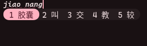

# Fcitx5 Theme Capsule

fcitx5 胶囊皮肤

完美的胶囊形，完美的半圆

## 修改配色

1. 修改 `background.svg` `candidate.svg` 中的 fill 颜色
2. 修改 `theme.conf` 中的 `NormalColor` 和 `HighlightCandidateColor` 属性

## 修改圆角

默认圆角为 9px，推荐字体大小 12px。可以根据需要的字体大小修改 svg 圆角大小和 conf 文件边距配置。